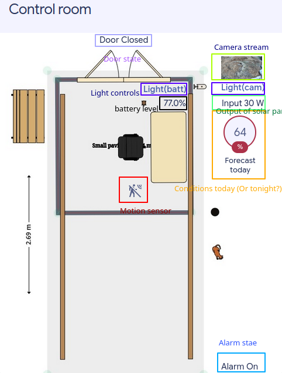
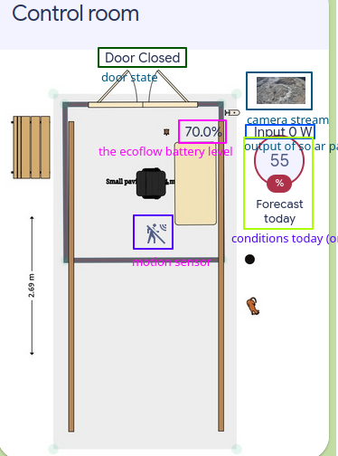

# 2D View floorplan card

EDIT: The new CtrlPanel/Vega dashboards do not include this, we may return it soon and better.

Things on this page may change very quickly; see "last updated" at the bottom of this page. Thanks

The 2D View floorplan card is on the 2D View tab.

There are different versions



Not the best experience when dark mode enabled.

Not the best experience on phone.

The entire Control Room moves on rails. This movement is visualized on the 2D View floorplan card - the building's position on the map changes to reflect whether it is "Open" or "Closed."

While the building itself moves across the map, the graphical representation of the doors on the structure is static. The doors in the image will always look the same regardless of their actual state. To verify if the doors are physically open or closed, always refer to the Door status located above the doors on the 2D View floorplan card.

See screenshot:

<figure><figcaption></figcaption></figure>



Coming soon....



Not the best experience when dark mode enabled.

Not the best experience on phone.

The entire Control Room moves on rails. This movement is visualized on the 2D View floorplan card - the building's position on the map changes to reflect whether the system is "Open" or "Closed."

While the building itself moves across the map, the graphical representation of the doors on the structure is static. The doors in the image will always look the same regardless of their actual state. To verify if the doors are physically open or closed, always refer to the Door status located above the doors on the 2D View floorplan card.

See screenshot:

<figure><figcaption></figcaption></figure>



Admin only, coming soon....



