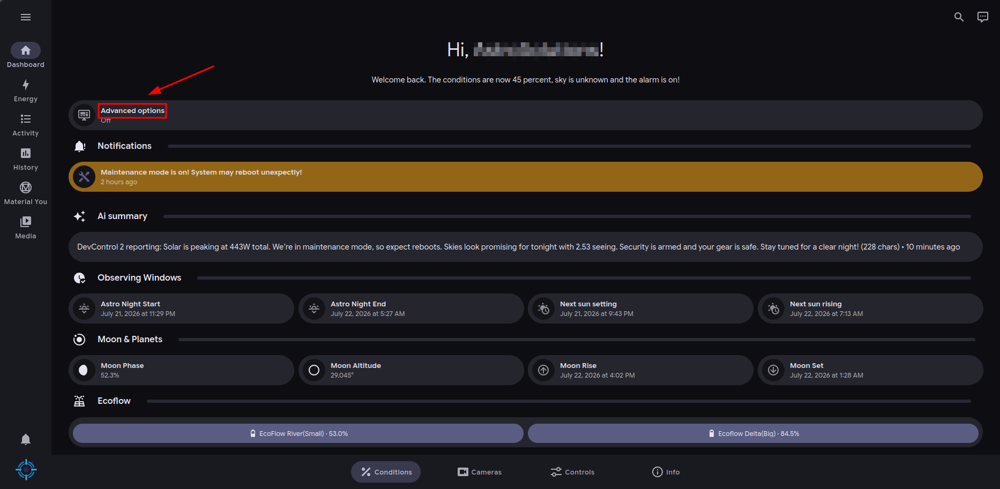

# Advanced features

OUTDATED FOR CTRLPANEL AND VEGA

DevControl2 has some advanced features in the Conditions tab that are hidden by default for regular users.

They include (this list may not be completely correct - it is just approximate information)

* Solar forecast
* Tapo sensors/hub
* Graphs and some solar math

### How to enable them



### Click on "Advanced options" on the Conditions tab.

<figure><figcaption>
Screenshot showing where the "Advanced options" togle is
</figcaption></figure>



### Enjoy


You can turn them off anytime you want.



