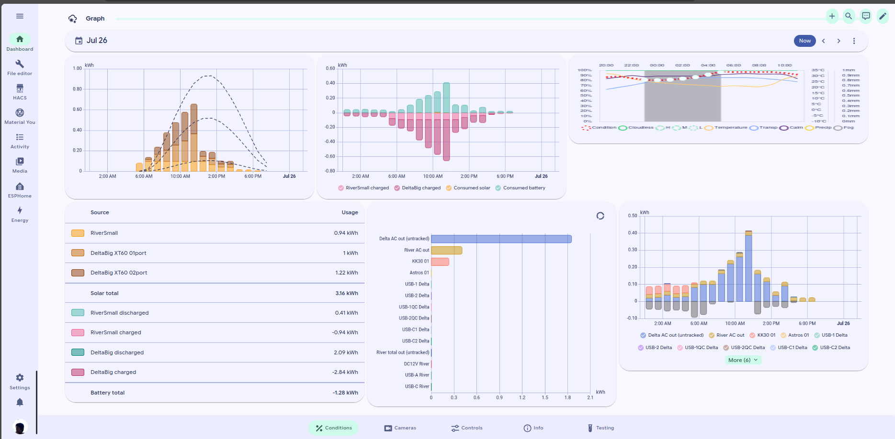

# Understand graphs

We have some graphs!

To see them, you must have advanced options enabled!

<figure><figcaption>
Screenshot of graphs section on the Conditions tab
</figcaption></figure>

So there is:

* Date picker for the solar graphs.
* Solar production with forecast.
* Battery in / out
* Astroweather conditions
* Some solar math
* What devices ate how much from the battery
* More detailed battery in / out

