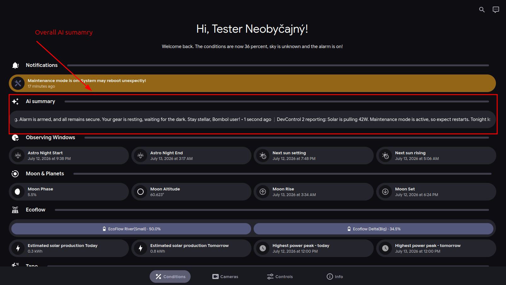

# Overall AI summary

## Overall AI summary

The AI summary appears at the top of the **Conditions** tab.

<figure><figcaption></figcaption></figure>

### What it shows

The AI summary provides a short briefing from available DevControl2 data. It can include solar production, EcoFlow battery status, weather, and observing conditions.

Treat it as a convenience feature. Confirm important values in their dashboard cards.

### Example

“Solar input is low under heavy cloud. EcoFlow battery is 66%. Tonight’s observing conditions are poor.”
