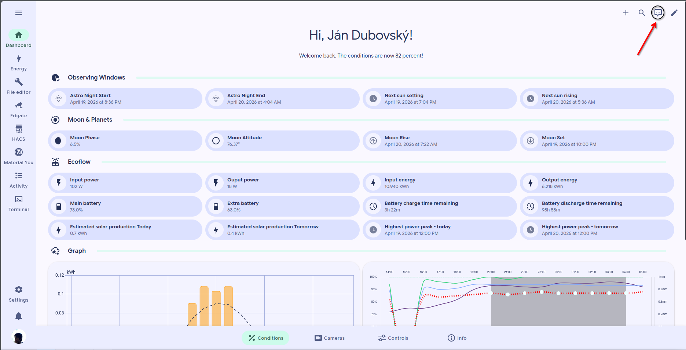
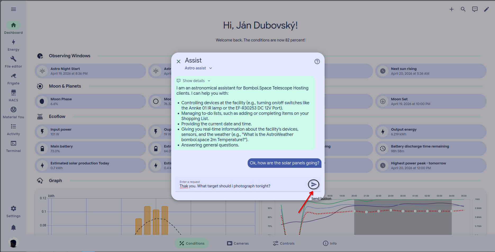

# Use Assist



### Open Assist

Select the message bubble at the upper-right corner of the main dashboard.

<figure><figcaption></figcaption></figure>



### Ask a question

Ask one clear question at a time.


_Requesting a roof move is planned but not supported yet._



To avoid API error codes, please don't spam the assistant. About 5 questions per minute is the safe limit.


<figure><figcaption></figcaption></figure>



### What Assist can answer

Assist can answer questions about available, configured Home Assistant data. This includes solar input, EcoFlow battery status, Tapo door positions, and observing conditions.

### What Assist cannot safely do

Assist does not replace safety checks or facility procedures. Do not use it as the only source for roof, weather, power, or emergency decisions.

Roof-move requests are not supported. Confirm dashboard states before acting.

### Example questions

* “What is the EcoFlow battery level and input power?”
* “Is the control room door open?”
* “What are tonight’s observing conditions?”
