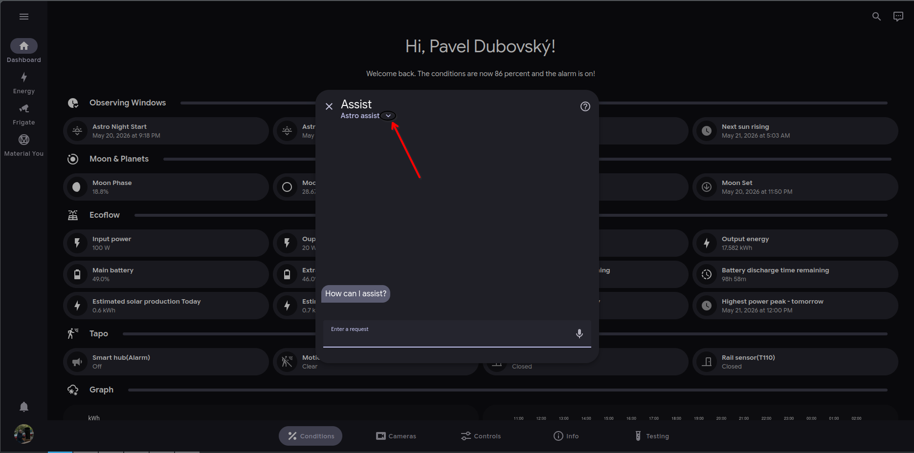
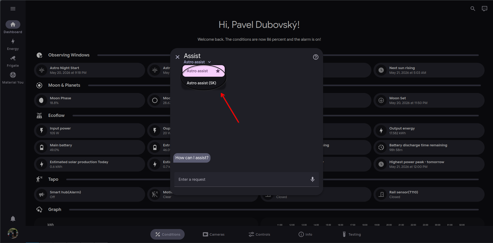

# Switch between assists

We currently provide "Astro assist" and "Astro assist (SK)"

You can select the one you want to use using a dropdown menu.



### Open the dropdown menu

<figure><figcaption></figcaption></figure>



### Select the assist you want to use

<figure><figcaption></figcaption></figure>



