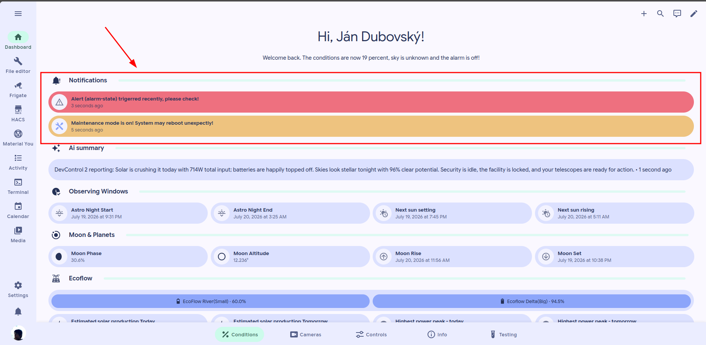

# In-dashboard notifications

## In-dashboard notifications

DevControl2 includes in-dashboard notifications to keep you informed about important updates.

### Where notifications appear

They appear at the top of the **Conditions** tab.

### Notification expiry

Most event notifications expire 20 minutes after their triggering event.

The notification disappears automatically after that period. A new event creates a new notification.

Persistent status notifications can remain visible until their condition clears.

### Read a notification

The following screenshot shows an example:

<figure><figcaption></figcaption></figure>

### Available notifications

**Red notifications** report recent alerts, motion, door activity, or camera events.

**Yellow notifications** report low EcoFlow battery, failed roof requests, or maintenance mode.

### Manage notifications

You cannot dismiss or configure notifications from the dashboard.

### Notification settings

Contact the administrator to request notification changes for your account.

The administrator may disable selected notifications.

### When a notification needs action

Read the displayed instructions before taking action.


For equipment-safety alerts, see [Understand alerts](../understand-alerts.md).

