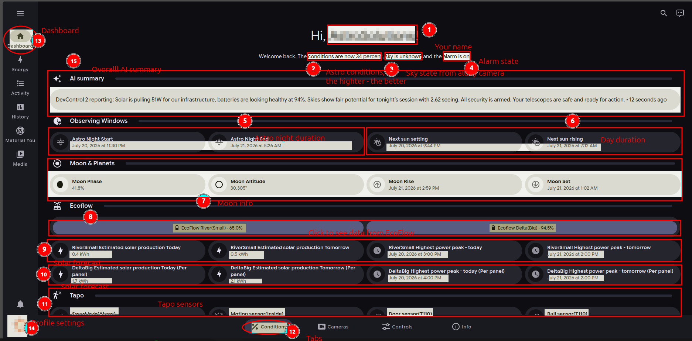
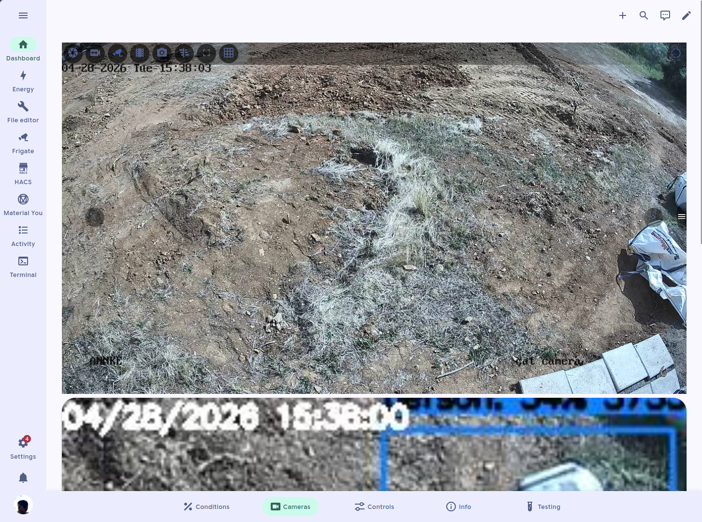
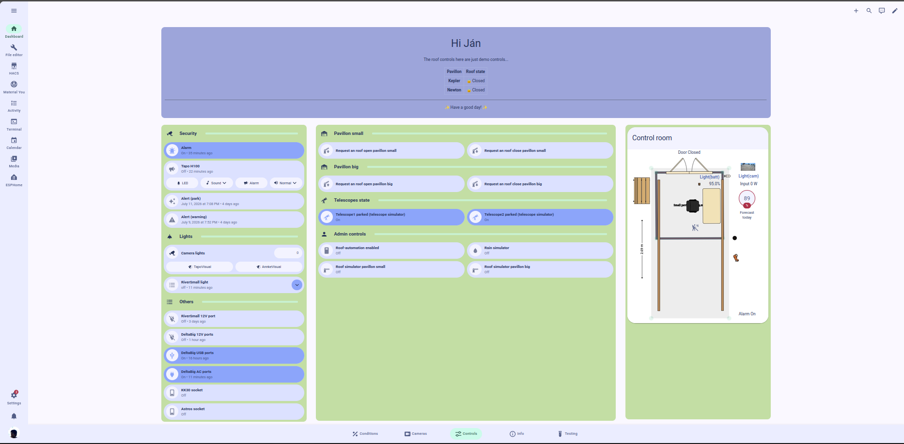
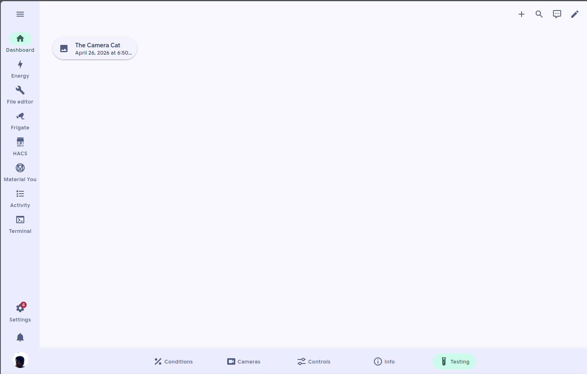

# Main dashboard

Things on this page may change very quickly (including screenshots and their alt texts); see "last updated" at the bottom of this page. Thanks

How to open it:

* After receiving the login credentials mail, it should be the default dashboard
* Anyway, it is in the left sidebar unless you have disabled it



Observing windows, moon information, EcoFlow entities(in pop-ups) like the battery level, Tapo entities like the door sensor, some graphs, and the AI summary. As of July 9, year 2026

<figure><figcaption>
Screenshot showing how does the main dashboard looks
</figcaption></figure>

<figure><figcaption>
Screenshot explaining the interface
</figcaption></figure>



For user role information, please see the [user roles](../other-informations/user-roles.md) page.

Currently, there are some bubble cards with some module. As for Jul 19 year 2026

Long loading is normal. As for April 27, year 2026

<figure><figcaption></figcaption></figure>



For user role information, please see the [user roles](../other-informations/user-roles.md) page.

Currently, there are some alarm controls for admins, roof demo controls (Only for admins), and some socket controls. As for Jul 28, year 2026

<figure><figcaption>
Screenshot made on 28.7.2026 from an user account
</figcaption></figure>

<figure><figcaption>
Screenshot made on 22.7.2026 from an admin account
</figcaption></figure>

<figure><figcaption>
Screenshot made on 29.4.2026 from an admin account
</figcaption></figure>



You need the [beta/alpha features](../other-informations/beta-alpha-features.md) enabled.

Want to see what is inside that tab? Go to [beta/alpha features](../other-informations/beta-alpha-features.md) and/or [changelog](https://app.gitbook.com/s/IG85gw75e9VMgpkRPrvS/).

<figure><figcaption></figcaption></figure>



Coming soon.

After it will be avalible, you still need to [request access](../other-informations/contact-us.md), and you will need [beta/alpha features](../other-informations/beta-alpha-features.md) enabled.



There is also an info tab including links to docs and Google Chat group.
