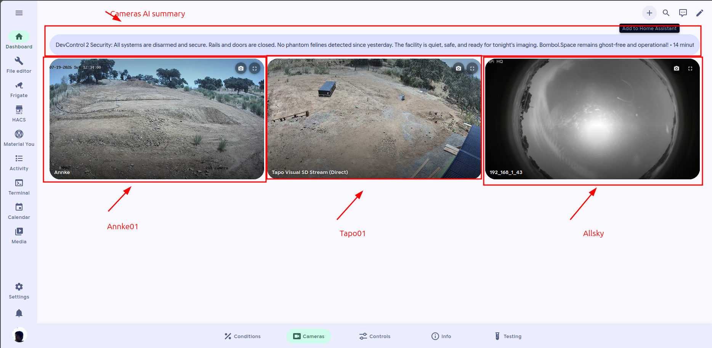
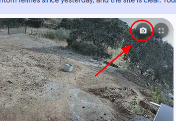

# Use the camera card



### Open Cameras tab in the main dashboard



### Try looking at them

There are three cameras; we call them: tapo01, annke01, and allsky.

<figure><figcaption>
Screenshot showing the Cameras tab
</figcaption></figure>



### Download snapshot

Did you catch an bird on allsky camera? Or rabbit eating plants?

You can download the snapshot by pressing the following button:

<figure><figcaption>
Screenshot showing how does the snapshot button looks like
</figcaption></figure>


