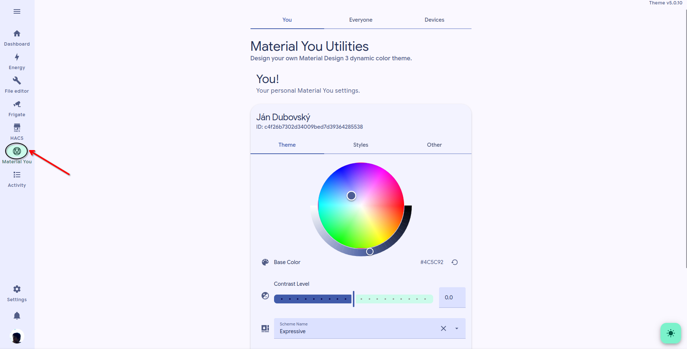

# Customize colors

DevControl2 uses **Material You Utilities** for color customization.

Open **Material You Utilities** from the sidebar to change the look of the interface.

This usually changes only your own view.



### Open Material You Utilities

Log in to Home Assistant.

In the sidebar, open **Material UI Utilities**.


If you don't see it in the sidebar, you may have already hidden it. Try following the steps in [Customize sidebar](customize-sidebar.md) to make it appear again.



If you see this message: `Some or all input helpers not setup! Ask an Home Assistant administrator to do so.` , [contact us](../other-informations/contact-us.md).




### Choose the color style you want

Select the colors or theme that work best for you.

For example, you may prefer:

* a dark theme at night
* a light theme during the day
* a higher-contrast theme for readability&#x20;



### Save and check the result

Confirm that the colors, cards, and text look correct.




If a change does not appear immediately, refresh the page once.


### If the colors do not change

Try this:

* refresh the page once
* log out and log in again
* reopen **Material UI Utilities**
* follow the steps on [Refreshing page](../troubleshooting/refreshing-page.md)

If the issue continues, contact us at devcontrol2@bombol.space

### Example screen

<figure><figcaption>
Theme settings view
</figcaption></figure>

### Related pages

* [Log in](log-in.md)
* [Customize sidebar](customize-sidebar.md)
* [Refreshing page](../troubleshooting/refreshing-page.md)
