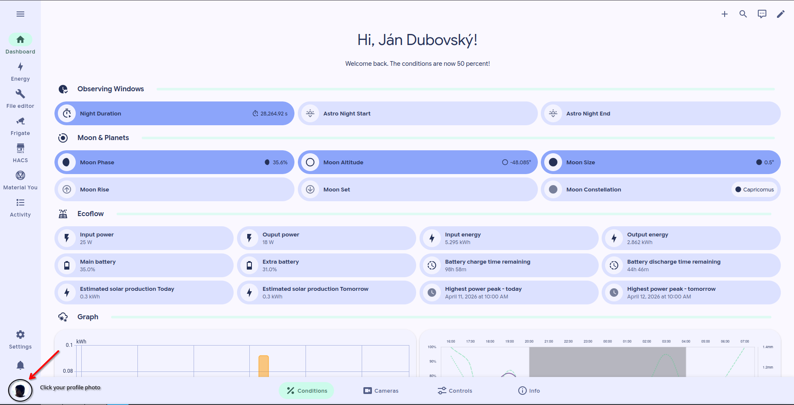
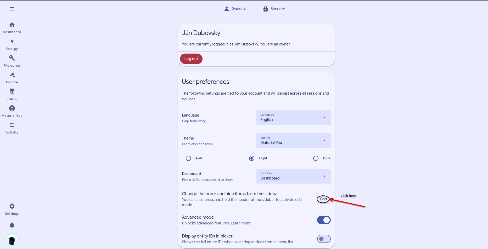

# Customize sidebar

## Customize sidebar

You can adjust the sidebar so the most important pages stay easy to reach.

This is useful if you want a cleaner layout or faster access to daily controls.

### What you can change

Changes apply only to your profile.

* Reorder sidebar items.
* Hide items you do not use.
* Keep important dashboards near the top.


Some sidebar items may be fixed by the system configuration and cannot be changed for regular users.


### Change the sidebar



### Open your profile

Log in to Home Assistant.

Then open your user profile.



### Find sidebar settings

Look for the section that controls sidebar visibility or order.

Open the sidebar customization view.



### Reorder or hide items

Move the items you use most to the top.

Hide items you do not need every day.



### Save and check the result

Return to the main screen.

Confirm that the sidebar now matches the way you work.



### Suggested setup

For most users, this order works well:

1. Dashboard
2. Energy
3. Frigate
4. To-do lists

### Restore a hidden sidebar item

Open your user profile. Then open **Change the order and hide items from the sidebar**.

Find the hidden item. Select its visibility control to show it again.

Return to the sidebar and confirm that the item appears.

If it does not appear, refresh the page once. Then sign out and back in.

Some items are controlled by the system configuration. Contact the administrator if the visibility control is unavailable.

### Photo guide

<figure><figcaption>
Open settings
</figcaption></figure>

<figure><figcaption>
In settings
</figcaption></figure>

### Related pages

* [Log in](log-in.md)
* [Reset password](reset-password.md)
* [Refreshing page](../troubleshooting/refreshing-page.md)
