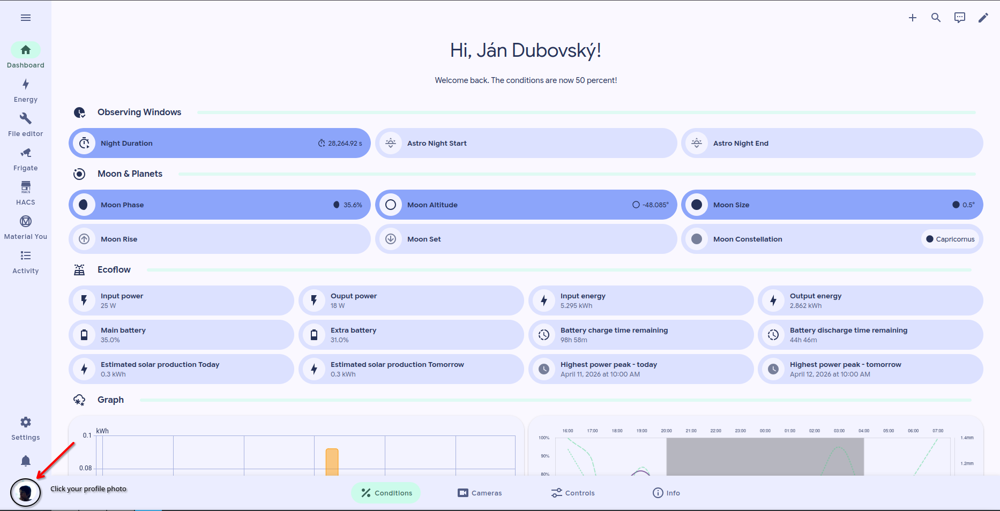
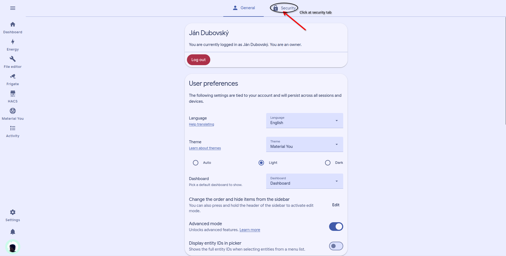

# Reset password

## Reset password

Use this page if:

* you want to change your current password
* you forgot your password
* you think someone else may know it
* you recieved the welcome email


Resetting the password should be the first step after the first login, because of security - we send the password by email.


### If you can still log in

If you know your current password, change it as soon as possible.



### Open your profile

Log in to Home Assistant.

Then open your user profile.



### Change your password

Find the password section.

Enter your current password.

Enter your new password twice.



### Save the change

Save the new password.

Then sign in again if the session is refreshed.



### If you cannot log in

If you do not know your current password, contact support:

* **Email:** [devcontrol2@bombol.space](mailto:devcontrol2@bombol.space)

Include:

* your username
* a short description of the problem
* whether you still have access to the email used for your account


You should write from the mail you have in our Google chat group


### If you think your account was compromised

Do this immediately:

1. Change your password, if you still can log in.
2. Log out on shared or borrowed devices.
3. Contact support at [devcontrol@bombol.space](mailto:devcontrol@bombol.space).
4. Mention that you suspect unauthorized access.

### Good password rules


Our instance is public, please make a strong password


Use a password that is:

* long
* unique
* not reused from another service
* at least 10 characters

Avoid:

* simple words
* names
* dates of birth
* reused old passwords

### Photo guide

<figure><figcaption>
Open settings
</figcaption></figure>

<figure><figcaption>
Open the security page
</figcaption></figure>

### Related pages

* [Log in](log-in.md)
* [Refreshing page](../troubleshooting/refreshing-page.md)
