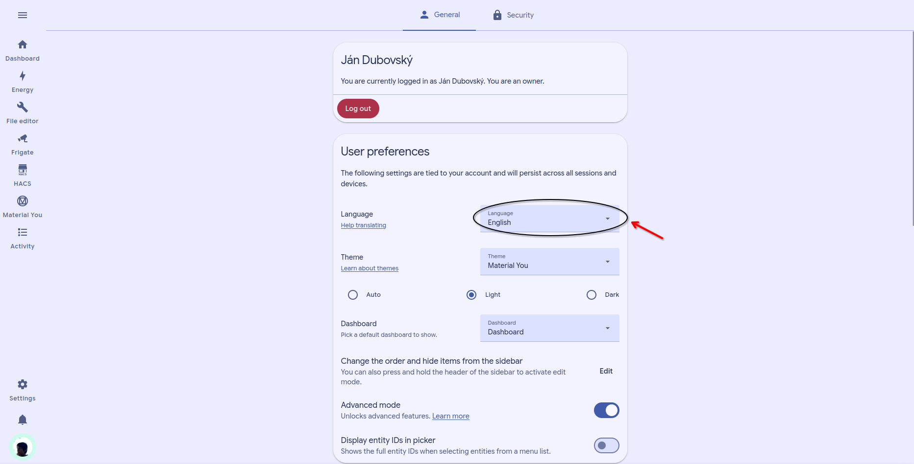
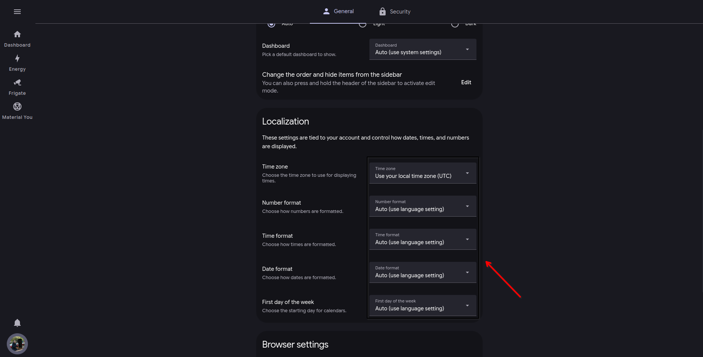

# Set language



### Open settings

Select your username or initials at the bottom of the sidebar.

Open your Home Assistant user profile.



### Set language

Select your preferred language from the language menu.



### Verify timezone

Check the timezone shown in your user profile.

Choose the timezone for your current location. Then save the change.

Reload the dashboard. Confirm that local times match your expected time.




The timezone controls displayed times, including notifications and observing windows.


<figure><figcaption></figcaption></figure> <figure><figcaption></figcaption></figure>

